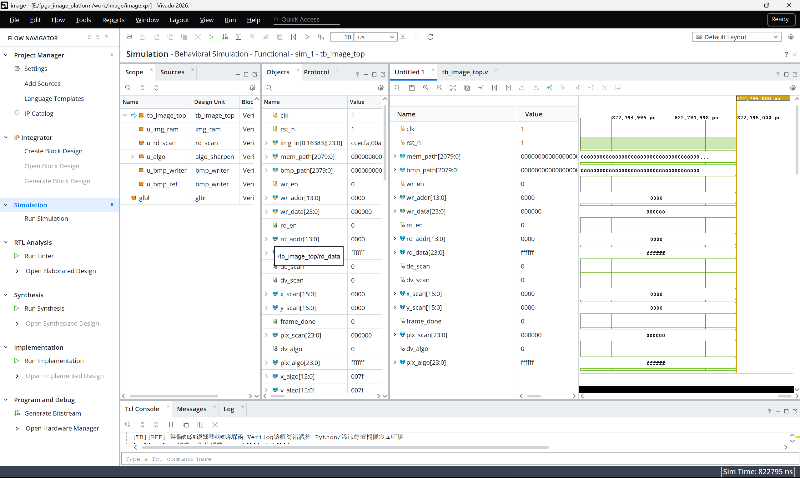
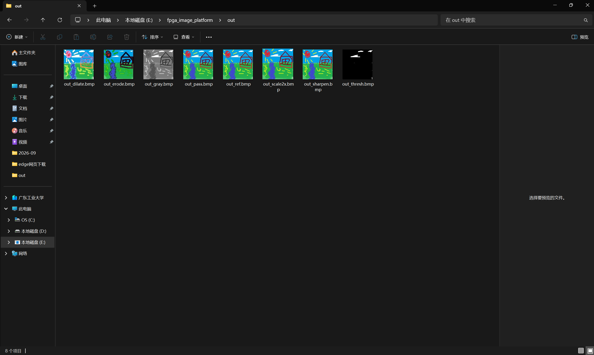

# FPGA 图像处理仿真验证平台

用 **Verilog-2001 + Vivado xsim** 实现的一条完整图像处理链路：

```
图片 / 测试图案 → 片上帧缓存(img_ram) → 光栅扫描读出(rd_scan) → 【算法】 → BMP 位图输出
                                                                  │
        直通 / 灰度 / 颜色识别+目标检测 / 3×3 膨胀 / 3×3 腐蚀 / 最近邻 2 倍放大 / 高斯锐化
```

“验证”也做在仿真内部：testbench **自带测试图案发生器、自带定点参考模型、自带逐像素比对与判定打印**，
因此七种算法的正确性判定完全在 Vivado 仿真里闭环完成 —— **不需要 Python、不需要 PowerShell、不需要任何第三方库**，
运行仿真只用 Vivado 自带的 `xsim`，一条 `[TB][REF] 判定 = PASS` 就直接打在 Tcl Console 里。

## 特性一览

| 项目 | 规格 |
| --- | --- |
| 图像分辨率 | 128 × 128 |
| 像素格式 | RGB888（24 bit） |
| 帧缓存 | 16384 × 24 bit 行为级双口 RAM，**读延迟 1 拍** |
| 处理吞吐 | 1 pixel / clk（10 ns 周期，100 MHz） |
| 算法选择 | 编译期宏切换，7 选 1 |
| 输出格式 | 24 位未压缩 BMP（54 字节头 + 自下而上 + 行 4 字节对齐） |
| 验证方式 | 仿真内参考模型 + 按坐标逐像素比对 + PASS/FAIL 判定 |
| 外部依赖 | 无（零 Python / 零外部脚本） |
| 定点策略 | 只用移位、加法、比较；**无乘法器、无除法器**；越界一律饱和而非截断 |

## 仓库结构

```
fpga_image/
├── rtl/                        可综合的设计代码（9 个文件）
│   ├── img_ram.v               帧缓存：行为级双口 RAM，读数据比地址晚 1 拍
│   ├── rd_scan.v               消隐光栅扫描读出：de/dv/x/y + RAM 读地址（★核心）
│   ├── win3x3_gen.v            3×3 邻域窗口生成：2 个行缓存 + 3 组移位寄存器（★核心）
│   ├── algo_pass.v             ① 直通（算法接口模板，1 拍寄存）
│   ├── algo_gray.v             ② 灰度化 Y = (77R+150G+29B) >> 8
│   ├── algo_threshold.v        ③ 颜色识别 + 目标包围盒在线统计
│   ├── algo_morph.v            ④⑤ 3×3 膨胀 / 腐蚀（MODE 参数切换）
│   ├── algo_sharpen.v          ⑥ 高斯模糊 + 锐化（有符号饱和）
│   └── algo_scale.v            ⑦ 最近邻 2 倍放大 / 2 倍缩小
├── tb/                         仅用于仿真的验证代码（3 个文件）
│   ├── tb_image_top.v          顶层 testbench：宏配置、三段式流程、参考模型自检
│   ├── pattern_gen.v           内置测试图案发生器（象限 + 棋盘 + 渐变 + 标记）
│   └── bmp_writer.v            BMP 文件写出器（54 字节头 + 自下而上像素写入）
├── scripts/                    在 Vivado Tcl Console 里运行的脚本（2 个文件）
│   ├── img2mem.tcl             24 位 BMP → data/image.mem（纯 Tcl，含 6 项校验）
│   └── set_algo.tcl            set_algo / set_src / set_paths（切算法、切数据源、修路径）
├── data/
│   ├── image.mem               图片数据：16384 行，每行 6 位十六进制 RRGGBB
│   └── in/test.bmp             源图（128×128、24 位未压缩 BMP）
├── out/                        仿真输出图（RTL 结果 + 参考模型结果）
├── test_example/               实测截图：Vivado 仿真界面、输出结果目录
└── report.md                   方案汇报：原理、代码片段、实测数据（推荐阅读）
```

> Vivado 工程目录 `work/`（含 `.xpr`、xsim 编译缓存等）**没有入库**，见 `.gitignore`；
> 拉到仓库后按下面「快速开始」重建工程即可，RTL 与 TB 的源码就是全部内容。

## 数据通路

```
① 装载阶段：把一帧图像写进片上 RAM
   tb/pattern_gen.v（RTL 内部生成图案）──┐
   data/image.mem（$readmemh 读文本）────┴─→ img_ram 写口
                                                    │
② 处理阶段：                                    img_ram（16384×24bit）
   rd_scan（129×129 消隐光栅）── rd_en/rd_addr ──→ 读口 ── rd_data（晚 1 拍）
        │ de/dv/x/y
        ▼
   7 选 1 算法层（宏在编译期选择）
     · 逐像素类：pass / gray / threshold
     · 3×3 邻域类：dilate / erode / sharpen  ← win3x3_gen 提供 p00..p22
     · 坐标变换类：scale2x  ← 自己驱动帧缓存读口（不用 rd_scan）
        │ dout_dv/dout_pix/dout_x/dout_y
        ▼
③ 写出阶段：
   tb/bmp_writer.v（主路）──────→ out/out_<算法>.bmp
   参考模型 gold_img（TB 内）───→ out/out_ref.bmp（标准答案图）
   按坐标流式比对 ──────────────→ [TB][REF] 判定 = PASS / FAIL
```

三个阶段靠两个状态信号衔接：装载完成 → 启动扫描；写出完成（`bmp_done`）→ 打印汇总与判定。
全程无 CPU 干预、无总线握手，是一段确定性的硬件流水。

## 算法与验收结果

| 算法 | 说明 | 输出像素 | 关键实现 |
| --- | --- | --- | --- |
| `pass` | 直通（链路基准） | 16384 / 16384 | 1 拍寄存器直通 |
| `gray` | 灰度化 | 16384 / 16384 | `Y=(77R+150G+29B)>>8`，权重全拆成移位加法，**0 个乘法器** |
| `threshold` | 颜色识别 + 目标检测 | 16384 / 16384 | 6 个比较器 + 4 个坐标寄存器在线统计包围盒 |
| `dilate` | 3×3 膨胀 | 16384 / 16384 | `win3x3_gen` + 每通道比较器树取最大 |
| `erode` | 3×3 腐蚀 | 16384 / 16384 | `win3x3_gen` + 每通道比较器树取最小 |
| `scale2x` | 最近邻 2 倍放大 | 65536 / 65536 | 自己驱动帧缓存读口，源地址 = 输出坐标 `>>1` |
| `sharpen` | 高斯模糊 + 锐化 | 16384 / 16384 | (1,2,1;2,4,2;1,2,1)/16 加法树 + 有符号饱和 |

`report.md` 记录的实测结论：**7 个算法 7/7 通过**，仿真内参考模型比对结果为
**不一致像素 0 个、最大通道误差 0**；颜色识别算法在帧末打印的目标包围盒为

```
[algo_threshold] 目标检测结果：包围盒 x=[4..11] y=[4..11]，宽=8 高=8，像素数=64
```

## 快速开始（Vivado）

### 1. 重建工程（一次性，约 2 分钟）

1. Vivado → **Create Project** → RTL Project（原工程器件为 `xc7k70tfbv676-1`，可自选）
2. **Add Sources**
   - Add or create design sources → 加入 `rtl/` 下全部 9 个 `.v`
   - Add or create simulation sources → 加入 `tb/` 下全部 3 个 `.v`
3. 把仿真顶层设为 **`tb_image_top`**
4. **Simulation Settings → `xsim.simulate.runtime` 改成 `all`**
   （否则仿真会被默认的 1000 ns 提前截断，看不到判定）

### 2. 跑仿真

Flow Navigator → **Simulation → Run Simulation → Run Behavioral Simulation**，
然后在 Tcl Console 里看判定：

```
[TB] 图案来源      = image.mem 文件（.../data/image.mem）
[TB] 算法          = PASS
[TB] 算法输出像素  = 16384 / 16384  OK
[TB][REF]   不一致像素   = 0
[TB][REF]   最大通道误差 = 0
[TB][REF]   判定 = PASS —— RTL 输出与参考模型逐像素完全一致
```

结果图在 `out/out_<算法>.bmp`，标准答案图在 `out/out_ref.bmp`，双击即可查看。

### 3. 切换算法 / 换图（都在 Vivado 的 Tcl Console 里执行）

```tcl
source scripts/set_algo.tcl
source scripts/img2mem.tcl

set_algo                 ;# 不带参数：列出全部算法及对应宏与输出文件
set_algo gray            ;# 切换算法（自动改宏 + 输出文件名 + ALGO_TAG 标签）
set_src mem              ;# 数据源 = data/image.mem
set_src pattern          ;# 数据源 = RTL 内置测试图案
set_paths                ;# 把绝对路径改写到当前仓库位置（换目录后必跑一次）

# 用自己的 24 位 BMP 替换 data/in/test.bmp 作为输入
img2mem data/in/test.bmp 128 128 data/image.mem
```

改完宏以后重新 **Run Simulation** 即可，无需手改任何代码。

> ⚠️ 两个脚本只在 `// ### ..._BEGIN ###` / `// ### ..._END ###` 标记之间改写宏块，
> 且显式按 UTF-8 读写，因此不会破坏中文注释；但**标记本身不能删**，删掉脚本就失效了。

## 宏配置速查

全部配置集中在 `tb/tb_image_top.v` 开头的宏配置区，设计原则是“只改宏、不改逻辑”。

| 宏 | 所在标记块 | 说明 |
| --- | --- | --- |
| `CFG_SCRIPT_MODE` / `CFG_GUI_MODE` | `MODE` | 数据源二选一：读 `data/image.mem` / 用 RTL 内置图案 |
| `PATH_MODE_ABS` | `MODE` | 用绝对路径。Vivado 仿真的工作目录是 `<工程>.sim/sim_1/behav/xsim/`，**不是工程根目录**，所以脚本模式下必须用绝对路径 |
| `ALGO_PASS` `ALGO_GRAY` `ALGO_THRESHOLD` `ALGO_MORPH_DILATE` `ALGO_MORPH_ERODE` `ALGO_SCALE_2X` `ALGO_SHARPEN` | `ALGO_SELECT` | 七个算法宏，**只允许打开一个**；一个都没打开时兜底按 `pass` 例化并打印提示，保证工程永远能编译 |
| `REF_CHECK` | 两个标记之间 | 仿真内参考模型自检开关，推荐常开；刻意放在 `ALGO_SELECT` 与 `OUT_NAME` 之间，批量换算法的脚本不会动它 |
| `IMG_MEM_PATH` `BMP_PATH` `REF_BMP_PATH` `ALGO_TAG` | `OUT_NAME` | 输入/输出路径与日志标签，由 `set_algo` / `set_paths` 自动维护 |

## 关键实现要点

* **帧缓存读延迟 1 拍是全链路时序设计的出发点**：凡是要与像素同拍的伴随信号（`de`/`dv`/`x`/`y`）都必须镜像同样的延迟，
  否则下游会把像素与坐标错配 —— 这正是 `rd_scan` 两级流水、以及各算法输出侧“四条信号写在同一 `always` 里一起寄存”的原因。
* **129×129 消隐光栅**：每行 W+1 个时隙（末格行消隐）、每帧 H+1 行（末行场消隐），共 16641 个时隙。
  消隐时隙像素按 0 处理，于是 3×3 算法的**边界补零天然发生**，不需要额外的补零状态机；`rd_en` 只由真实像素驱动，避免越界地址。
* **3×3 邻域窗口只用 1 拍延迟**：两块行缓存按当前列组合读出提供“右列”，移位寄存器 `r0/r1` 提供“中列/左列”，
  三者配成一组同拍寄存输出 `p00..p22`，输出坐标为 `din_x-1` / `din_y-1`。
* **`algo_scale` 特意不做输出寄存**：`rd_data` 已经比地址晚一拍，而 `dout_dv/x/y` 是比地址再晚一拍的寄存器；
  若把数据再打一拍，整幅输出图会整体右移一个像素。它自己产生 `rd_en/rd_addr`，因为源地址是坐标变换算出来的，无法靠顺序扫描得到。
* **定点运算策略**：常数乘法拆成移位加法（`(r16<<6)+(r16<<3)+(r16<<2)+r16`），常数除法拆成右移（`>>4`、`>>8`），
  负差显式 `$signed()`，越界一律 `clamp` 饱和（直接取低 8 位会让白色回绕成黑色、出现黑边）。
* **BMP 写出器的几何参数全部由参数推导**（`ROW_BYTES = ((W*3+3)/4)*4`），绝不写死数字；
  像素按 B→G→R 逐字节写、`wy` 从 `H-1` 递减到 0 实现自底向上、行尾补 0，最后 `$fclose` 刷盘。
* **仿真内参考模型“跟着数据走”**：参考模型的源图不是按公式重新生成的，而是抓取**实际写进 RAM 的那份像素**（`src_img`），
  因此无论输入是 RTL 图案、`image.mem` 还是自己的照片，参考模型都自动适配。
* **按坐标比对**：每个输出像素按**它自己报出的坐标**去 golden 图取值，而不是顺序取下一个，
  所以能抓住“像素值对但坐标错位”“多送/少送像素”“行列颠倒”这类顺序比对抓不到的问题。

## 数据文件格式

`data/image.mem`：

* 每行 6 位十六进制 `RRGGBB`，**行号（从 0 起）= 像素索引 = RAM 地址**；
* 行序为 y=0 在上（`img2mem.tcl` 会做行翻转，无论 BMP 是自下而上还是自上而下存储）；
* 当前文件共 16384 行、每行 7 字节（6 位十六进制 + LF），**无 CR**；
* testbench 用 `$readmemh` 读入后逐点做 **X 检查**，行数不足会直接报错并给出处理建议。

整条链路的数据闭环：

```
源图 BMP（自下而上、行 4 字节对齐、BGR 排列）
   │ img2mem.tcl：解析 54 字节头 + 行翻转 + 通道重排
   ▼
data/image.mem（线性 RRGGBB，行号 = y*W+x）
   │ $readmemh → 逐拍写入
   ▼
img_ram → rd_scan → 算法层 → bmp_writer.v（重新排成 BGR / 自下而上）
   ▼
out/out_<算法>.bmp（可直接双击查看）
```

## 输出产物

| 产物 | 说明 |
| --- | --- |
| `out/out_<算法>.bmp` | 各算法的 RTL 输出图，128×128 为 49206 字节，2 倍放大为 196662 字节 |
| `out/out_ref.bmp` | 参考模型给出的“标准答案图”；直通算法下应与 `out_pass.bmp` 逐字节相同，可直接用 `fc /b` 验收 |
| 仿真日志 | 像素计数、三条 32 位校验和、`[TB][REF]` 判定、总仿真周期数 |

> 仓库里的 `out/` 保留了历史结果图（`out_gray.bmp`、`out_sharpen.bmp`），重新跑仿真会覆盖它们；
> 其中 `out_ref.bmp` 只有 131 字节（仅文件头），是一次中断的仿真留下的残件，跑完一次仿真即会被完整覆盖。

## 已知限制与后续工作

| 限制 | 说明 / 后续方向 |
| --- | --- |
| 分辨率固定 128×128 | 已参数化，改 `IMG_W/IMG_H/ADDR_W` 与 `.mem` 行数即可；也可加缩放前端 |
| 仅支持 24 位未压缩 BMP | 压缩/其它位深需先转换（在画图里“另存为 24 位 BMP”即可） |
| 算法为整数定点实现 | 已覆盖基础图像处理算子；可扩展直方图均衡、双边/导向滤波、背景替换等 |
| 未做上板 | 当前以仿真验证为主；后续可加时序约束、综合上板与摄像/显示接口 |
| 存储为行为级模型 | 上板前可替换为厂商 RAM IP，接口不变（读写时序一致） |

## 文档

* [`report.md`](report.md) —— 方案汇报：总体数据通路、各模块实现原理（含 Verilog 代码片段）、
  算法设计、Testbench 自检机制、配套 Tcl 脚本、方案优势、实测结果与使用流程。

## 参考截图

| 仿真界面 | 输出结果 |
| --- | --- |
|  |  |
